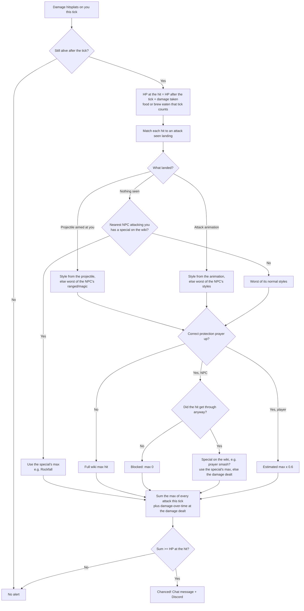
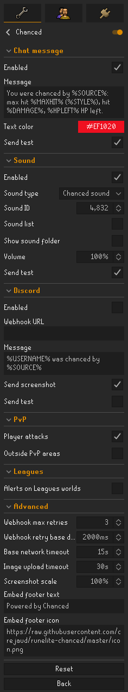

#  Chanced [](https://runelite.net/plugin-hub/crejaud) [](https://runelite.net/plugin-hub)

Alerts you (chat message, optional Discord webhook embed with screenshot) when something could have killed you and didn't:
its max hit was at least your HP and you survived.

In chat:

> You were chanced by Scurrius: max hit 8 (Magic), hit 0, 8 HP left.

On Discord:

> **Chanced!**
> **Durial321** was chanced by **Scurrius**
> Max hit 8 · Actual hit 0 · HP 8 → 8 · Attack style Magic · Your prayer Protect from Melee · World 302

## How a chance is decided

Every game tick on which you take damage:



- **Max hits** come from one download of the OSRS Wiki's `infobox_monster` data (id, name, max hit, attack style),
  cached in `.runelite/chanced/max-hits-v2.json` for 24 hours.
- **Attack styles** come from the names of RuneLite's animation and projectile IDs (`NPC_RAT_BOSS_ATTACK_MAGIC_01`
  is a magic attack), bundled with the plugin as a snapshot. An attack not in the snapshot falls back to the NPC's
  wiki attack styles, taking the worst case for you.
- Type `::chancedrefresh` to download the max hits again.
- **Protection the wiki tables separately:** dragonfire max hits follow your anti-dragon shield, Protect from Magic
  and (super) antifire; the Gauntlet's Hunllef follows your crystal armour tier, hits through prayer up to its prayed
  max, and its tornadoes and floor tiles count separately. Wiki maxes that depend on gear ("without Nose peg") are
  ignored.
- **Several hits on one tick** are added together. Two hitsplats from one attack count its max once.
- **Players** (Wilderness, PvP and Deadman worlds, or anywhere with *Outside PvP areas*): the max hit is a worst-case
  estimate from their visible gear with 99s, boosting potions, Piety/Rigour, a berserker ring, dragon bolts and 25%
  for special attacks. Shown as `~`.

## Settings



Hover a setting in RuneLite for its description. The *Send test* checkboxes untick themselves after sending. The sound
plays at its own volume, even with game sound effects muted; find sound IDs in the OSRS Wiki's
[list of sound IDs](https://oldschool.runescape.wiki/w/List_of_in-game_sound_IDs) (the *Sound list* checkbox opens it).

### Message macros

The chat and Discord messages replace these with the chance's details:

| Macro | Value | Example |
|---|---|---|
| `%USERNAME%` | Your character name | Durial321 |
| `%SOURCE%` | What could have killed you | Scurrius |
| `%MAXHIT%` | Its max hit (`~` in front for a PvP estimate) | 8 |
| `%DAMAGE%` | What it actually hit | 0 |
| `%HP%` | Your HP at the hit | 8 |
| `%HPLEFT%` | Your HP after the hit | 8 |
| `%STYLE%` | Attack style, or the special's name | Magic |
| `%PRAYER%` | Your protection prayer, or None | Protect from Melee |
| `%WORLD%` | World number | 302 |

## Network use

- OSRS Wiki API: one download of monster max hits per day.
- Your Discord webhook, only when Discord is enabled.

## Development

```sh
./gradlew build    # compile + unit tests
./gradlew run      # launch RuneLite with the plugin (developer mode)
./gradlew --init-script config/checkstyle/checkstyle.gradle checkstyleMain checkstyleTest   # RuneLite code style
```

Optional, when shipping an update anyway: refresh the attack style snapshot from the latest RuneLite release.

```sh
./gradlew build --refresh-dependencies     # download the latest RuneLite release into the Gradle cache
python scripts/generate_attack_styles.py   # regenerate attack_styles.txt from its runelite-api jar
```

The script uses the newest `runelite-api-<version>.jar` in the Gradle cache
(`~/.gradle/caches/modules-2/files-2.1/net.runelite/runelite-api/`), or a jar path you pass it.
