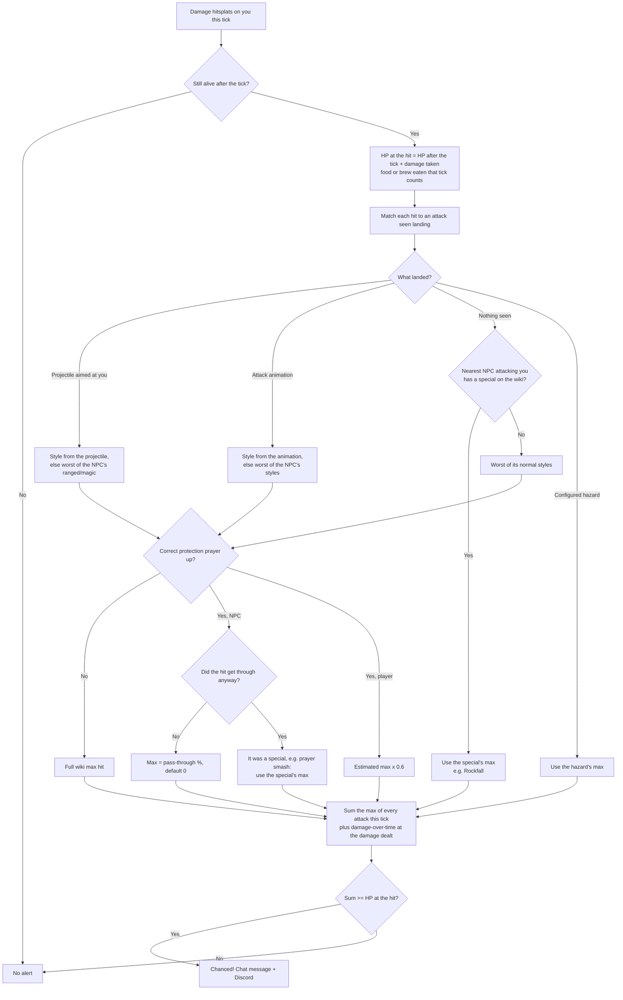

# Chanced [](https://runelite.net/plugin-hub/crejaud) [](https://runelite.net/plugin-hub)

Alerts you (chat message, optional Discord webhook embed with screenshot) when something could have killed you and didn't:
its max hit was at least your HP and you survived.

> **Durial321** was chanced by **Scurrius**
> Max hit **8** (Magic), actually hit **0**, at **8 HP**.

## How a chance is decided

Every game tick on which you take damage:



- **Max hits** come from one download of the OSRS Wiki's `infobox_monster` data (id, name, max hit, attack style),
  cached in `.runelite/chanced/max-hits-v2.json` for 24 hours. Type `::chancedrefresh` to download again.
- **Attack styles** come from RuneLite's named animation and projectile IDs (`scripts/generate_attack_styles.py`).
- **Several hits on one tick** are added together. Two hitsplats from one attack count its max once.
- **Players** (Wilderness, PvP and Deadman worlds, or anywhere with *Outside PvP areas*): the max hit is a worst-case
  estimate from their visible gear with 99s, boosting potions, Piety/Rigour, an assumed ring and ammo, plus the spec
  margin. Shown as `~`.

## Settings

| Setting | What it does |
|---|---|
| Chat message | Game chat message on a chance |
| Message | Template: `%USERNAME% %SOURCE% %MAXHIT% %DAMAGE% %HP% %STYLE% %WORLD%` |
| Webhook URL | Discord webhook(s), one per line. Blank turns Discord off |
| Send screenshot | Attach a screenshot to the Discord embed |
| Player attacks / Outside PvP areas / Spec margin / Assumed ammo and ring | PvP estimate |
| Unknown source HP | Alert on hits with no known source at or below this HP (0 = off) |
| Style overrides | `npcId:animationId:style` |
| Prayer pass-through | `npcId:style:percent` |
| Hazards | `graphic:id:max`, `projectile:id:max`, `region:id:max` |

## Network use

- OSRS Wiki API: one download of monster max hits per day.
- Your Discord webhook, only when you set one.

## Development

```sh
./gradlew build    # compile + unit tests
./gradlew run      # launch RuneLite with the plugin (developer mode)
./gradlew --init-script config/checkstyle/checkstyle.gradle checkstyleMain checkstyleTest   # RuneLite code style
```

To regenerate the attack style table after a RuneLite update:

```sh
python scripts/generate_attack_styles.py path/to/runelite-api-<version>.jar
```
